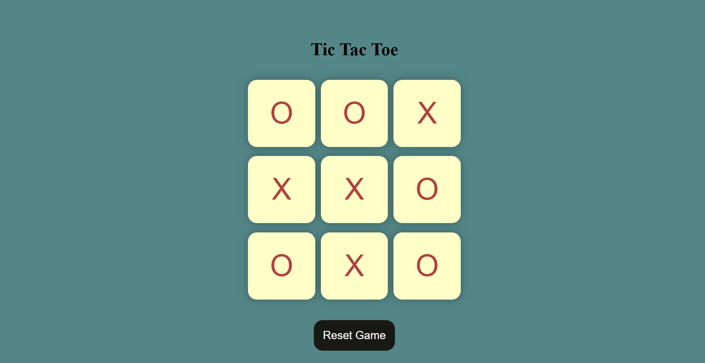
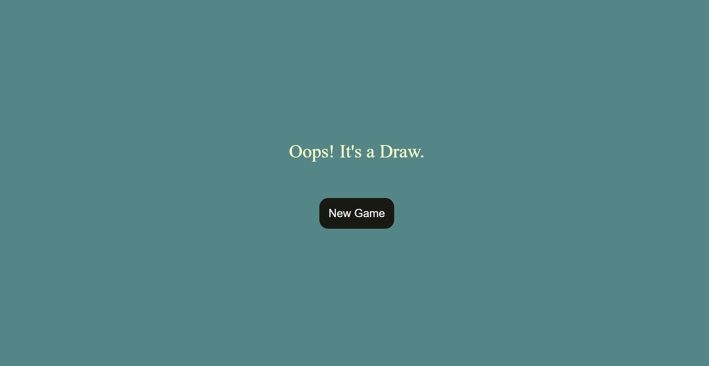

# ❌⭕ Tic-Tac-Toe-JS

A classic two-player Tic Tac Toe game built with HTML, CSS, and JavaScript, 
created as a practice project to strengthen my understanding of array logic 
and game-state handling in JavaScript.

## How It Works
- Two players take turns clicking boxes to place O and X
- The game checks after every move whether any winning pattern is completed
- If a player gets three in a row (horizontally, vertically, or diagonally), 
  they are declared the winner
- If all 9 boxes are filled with no winner, the game shows a "Draw" message
- "Reset Game" clears the board and restarts the current game
- "New Game" starts a fresh round after a win/draw

## JS Concepts Practiced
- DOM manipulation and event listeners
- Array of winning patterns checked using loops
- Tracking game state (turns, move count) with variables
- Conditional logic for win/draw detection
- Disabling/enabling elements dynamically
- Toggling visibility with CSS classes

## Technologies Used
- HTML5
- CSS3
- JavaScript

## Preview

## Author
Sehar Waseem  
Software Engineering Student
